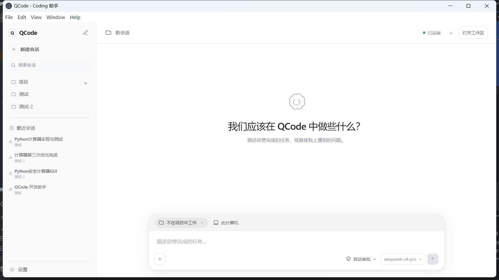
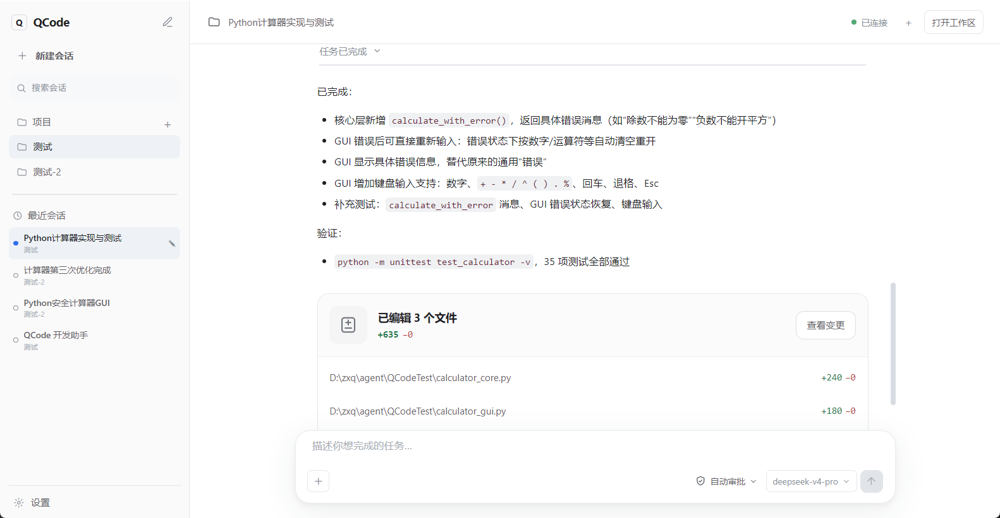

# QCode

QCode 是一款本地桌面 AI 编程助手，由 Spring Boot、AgentScope、React、Vite 和 Electron 构建。它提供项目与会话管理、流式对话、代码文件预览、工具执行、模型配置、MCP、技能和权限控制。

## 下载与安装

当前提供 Windows x64 版本，安装包已经内置 Java 21，普通用户不需要单独安装 Java、Maven 或 Node.js。

- [下载 Windows 安装版](https://github.com/zxqQing/QCode/releases/latest/download/QCode-1.0.0-x64-setup.exe)
- [下载 Windows 便携版](https://github.com/zxqQing/QCode/releases/latest/download/QCode-1.0.0-x64-portable.exe)
- [查看全部版本与更新说明](https://github.com/zxqQing/QCode/releases)

| 版本 | 适合场景 | 使用方式 |
| --- | --- | --- |
| 安装版 | 长期使用 | 运行安装程序，可选择目录并创建桌面快捷方式 |
| 便携版 | 临时体验、U 盘携带 | 直接双击运行，无需安装；首次启动会稍慢 |

> 当前安装包尚未进行商业代码签名。Windows 首次运行时可能显示 SmartScreen 提示，请确认文件来自本仓库的 Releases 页面。

### 安装效果


首次启动后，请进入“模型设置”，添加模型服务商、模型名称和 API Key。用户配置、项目、会话及技能数据保存在当前用户目录的 `.qcode/` 中；便携版删除 EXE 不会自动删除这些数据。

## 界面预览





## 主要能力

- 多项目、多会话的本地管理
- 流式 AI 对话、工具调用与执行过程展示
- 代码文件预览和会话变更检查
- DashScope、OpenAI 兼容接口、Anthropic 与 Ollama 模型配置
- MCP 服务、技能和权限模式管理
- Electron 桌面端自动启动内置 Spring Boot 后端

## 项目结构

```text
.
├── QCode/                 # Java 21 + Spring Boot 后端
├── QCode-Desktop/         # React + Vite + Electron 桌面端
├── docs/images/           # README 图片
└── README.md
```

## 本地开发

开发环境需要：

- JDK 21 或更高版本
- Maven 3.9 或更高版本
- Node.js 20 或更高版本及 npm

启动后端：

```powershell
cd QCode
mvn spring-boot:run
```

另开终端启动前端：

```powershell
cd QCode-Desktop
npm install
npm run dev
```

构建包含 Java 运行时的 Windows 安装版和便携版：

```powershell
cd QCode-Desktop
npm install
npm run electron:build
```

构建产物位于 `QCode-Desktop/release/`。

## 配置与数据安全

模型配置保存在 `.qcode/config/model.json`。请勿将 API Key、个人模型配置或其他凭据提交到公开仓库。常用后端配置可通过 `QCODE_MODEL`、`QCODE_WORKSPACE`、`QCODE_CORS_ORIGINS` 和 `QCODE_BACKEND_PORT` 环境变量调整。

## 子项目文档

- [Spring Boot 后端说明](QCode/README.md)
- [Electron 桌面端说明](QCode-Desktop/README.md)

## License

[MIT](LICENSE)
